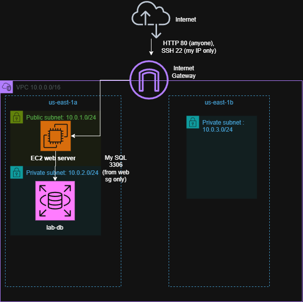
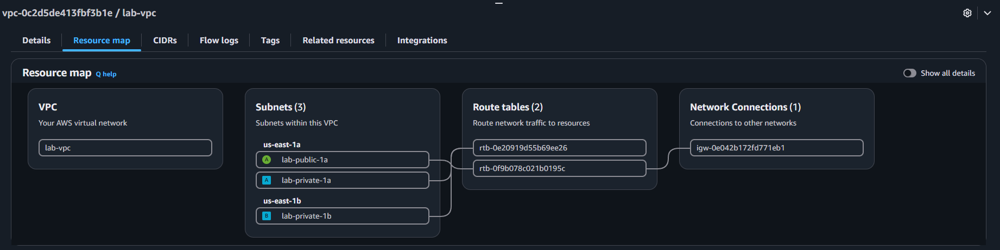
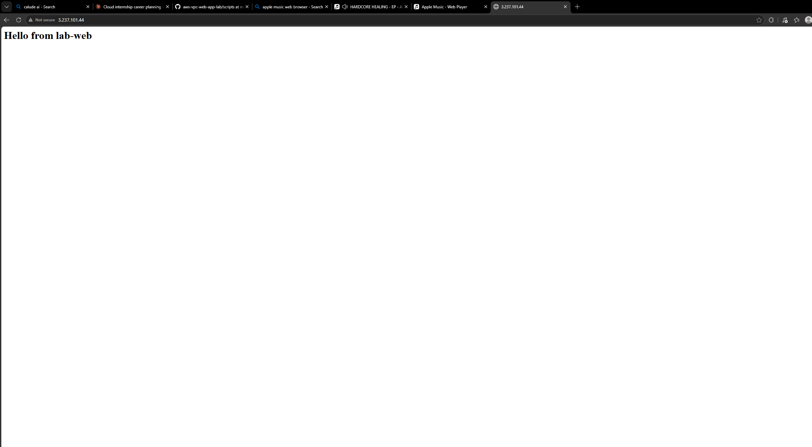
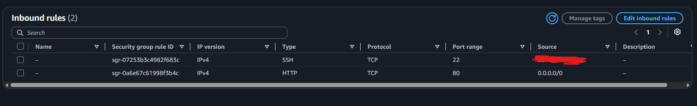
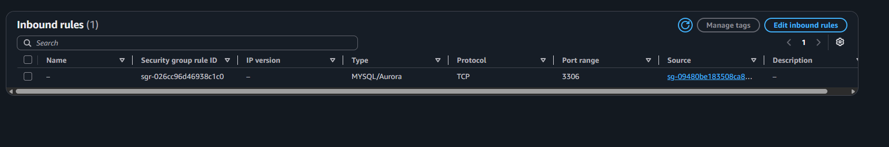
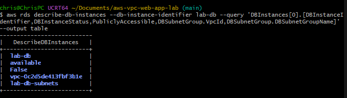
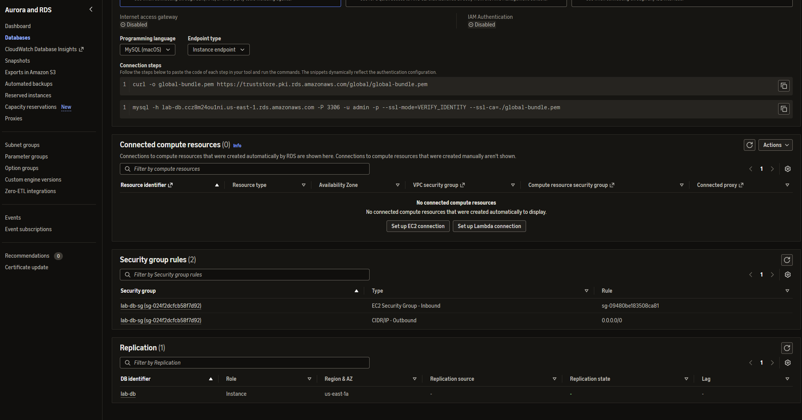
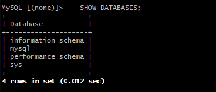

# AWS Three-Tier Network Lab

A small, secure AWS environment built with the AWS CLI: a custom VPC with public and private subnets, a public EC2 web server, and a private RDS MySQL database that only the web server can reach.

   
   

## What this builds

- A custom **VPC** (`10.0.0.0/16`) with one public subnet and two private subnets across two Availability Zones
- An **internet gateway** and a public route table, so only the public subnet has a route to the internet
- An **EC2 web server** (Amazon Linux 2023, Apache) in the public subnet
- A **private RDS MySQL** database with no public access
- **Security groups** that control exactly which traffic is allowed

## Services used

| Service | Role |
|---|---|
| VPC, subnets, route tables, internet gateway | Network layout and routing |
| EC2 | Web server |
| Security groups | Traffic control between internet, web tier, and database |
| RDS (MySQL) | Private database |
| AWS CLI | Builds and deletes everything from scripts |

## Network layout

| Subnet | CIDR | AZ | Type |
|---|---|---|---|
| lab-public-1a | 10.0.1.0/24 | us-east-1a | Public (route to internet gateway) |
| lab-private-1a | 10.0.2.0/24 | us-east-1a | Private (local route only) |
| lab-private-1b | 10.0.3.0/24 | us-east-1b | Private (local route only) |

## Design decisions

- **Public and private subnets.** Only the web server is internet-facing. The private subnets have no route to the internet gateway, so nothing in them is reachable from outside.
- **Security group chaining.** The database's security group allows port 3306 only from the web server's security group, not from an IP range. Any instance in the web tier can reach the database, and nothing else can.
- **SSH locked to one IP.** The web security group allows SSH (port 22) only from a single `/32` address. HTTP (port 80) is open to everyone, since it's a public site.
- **Two private subnets in two AZs.** RDS requires a subnet group that spans at least two Availability Zones, even for a single instance.
- **No public database.** The RDS instance is created with `--no-publicly-accessible`, so it has no public address.
- **Keys stay out of the repo.** The SSH key pair is stored outside the project folder, and `.gitignore` blocks `.pem`, `.env`, and state files.

## Evidence

**VPC resource map:** three subnets, route tables, and the internet gateway.

**Web server running:**

**SSH session to the web server (public subnet, 10.0.1.x):**

**Web security group:** HTTP open to the internet, SSH restricted to one IP (redacted).

**Database security group:** MySQL (3306) allowed only from the web security group.

**RDS instance:** `lab-db` is available, not publicly accessible, in `lab-vpc`, using subnet group `lab-db-subnets`.

**Web server connecting to the private database:**

## How to deploy

1. Install and configure the AWS CLI (`aws sts get-caller-identity` should work) and set the region to `us-east-1`.
2. Run the commands in `scripts/deploy.sh` in order, in one terminal session. The script is written as a step-by-step record, so run it a phase at a time.
3. `scripts/user-data.sh` installs Apache and creates the test page on first boot.
4. The database password is entered at a prompt (`read -s`) and is never stored in the repo.
5. Connect with `ssh -i ~/.ssh/lab-key.pem ec2-user@<public-ip>`, then `mysql -h <db-endpoint> -u admin -p`.

## Security considerations

- Least exposure: only ports 80 and 22 are open on the web server, and 22 is limited to one IP.
- The database is private, with access limited to the web tier's security group.
- No credentials, keys, or account IDs are committed to the repository.

## Cost

Built on free credits. A `t3.micro` web server and a `db.t3.micro` database ran roughly for a few days and was deleted after testing. Cost was roughly a few cents per hour when it was running

## Teardown

Everything was deleted after testing (database first, then the server, security groups, and network) to stop charges. See `scripts/teardown.sh`.

## What I learned and next steps

- How routes, not subnet names, make a subnet public or private
- How security group references control traffic between tiers
- Why RDS needs subnets in two Availability Zones

**Next:** rebuild this in Terraform, add an Application Load Balancer and HTTPS, run the web tier across two AZs with Auto Scaling, and add a NAT gateway for private outbound access.